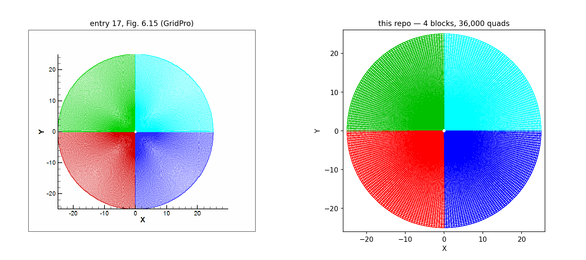
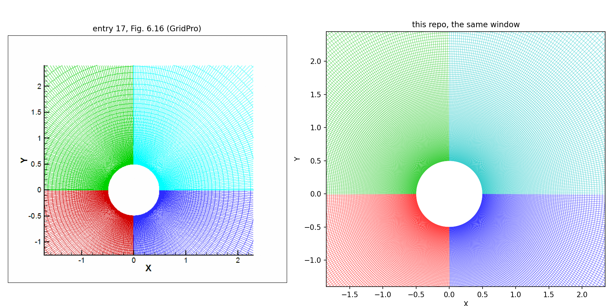
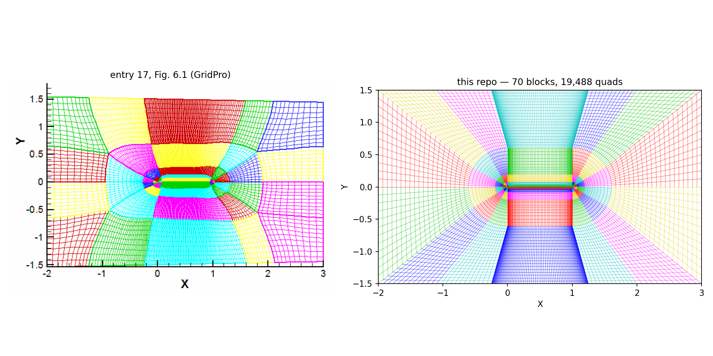
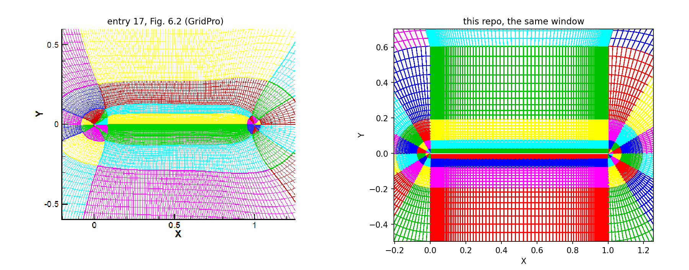
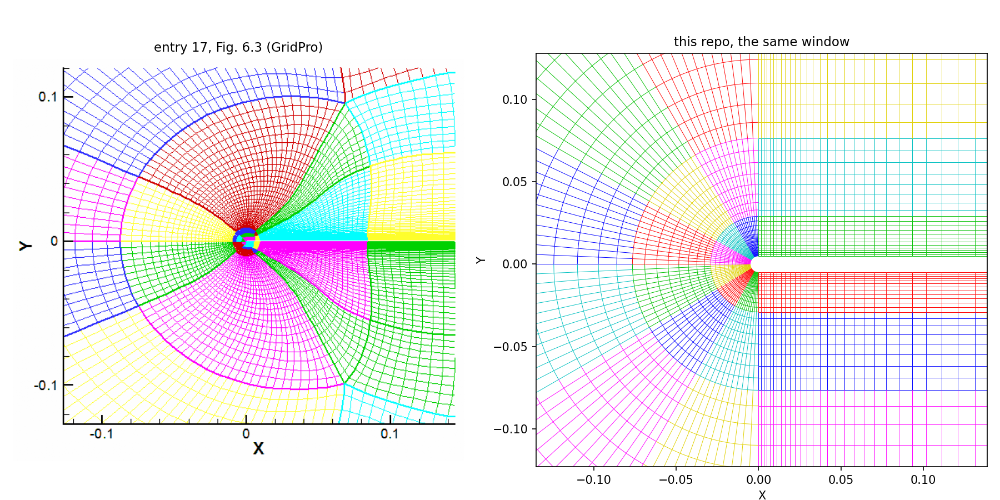
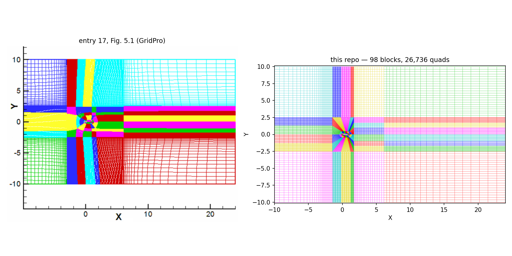
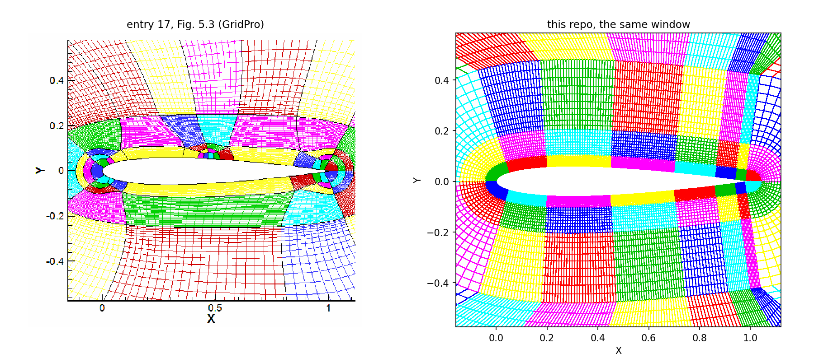
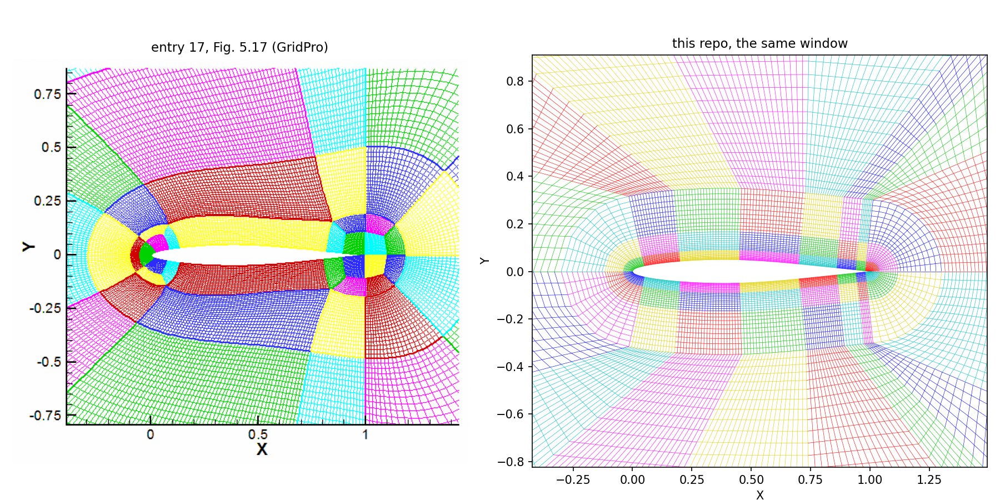

# Reproducing the eight Allampalli (2010) GridPro grids with this repo's mesher

**A RESEARCH NOTE, like the others beside it.** Not `.claude/rules/*.md` (what the rule is), not
`docs/design_notes/` (why a shipped rule was chosen). It takes eight published GridPro figures,
builds the closest mesh this repo's `MESH_MODE 1` path can produce for each, puts them side by
side, and says what is the same, what is not, and what the model would need in order to close the
gap. Nothing here is binding; **no rule, gate, test, `config/`, `examples/`, `src/` or `include/`
file was changed to write it.** Run and measured 2026-11-26.

**What was asked.** Draw, as closely as possible, the grids in
`gridpro-mesh-samples/entry17-allampalli2010-fig5*` and `...fig6*`; where the current
functionality or topology cannot reach them, say so and propose something workable.

**Markers.** **[V]** = measured by me in this session, or read off a figure I opened myself.
**[I]** = my own inference from a **[V]** fact.

**Rebuild everything** (meshes are not committed — four `.vtk` files are 55 MB):

```bash
bash docs/research/allampalli-2010-reproductions/rebuild.sh
```

---

## 0. The four cases, and what they cost

The eight target figures are **four grids seen from eight windows**. One generator per grid; the
aerofoils share one.

| target figures | case | generator | blocks | quads | triangles |
|---|---|---|---|---|---|
| 6.15, 6.16 | 2-D cylinder | `make_cylinder.py` | **4** | 36,000 | 72,000 |
| 6.1, 6.2, 6.3 | flat plate | `make_plate.py` | **70** | 19,488 | 38,976 |
| 5.1, 5.3 | NACA 0012 | `make_airfoil.py --case naca0012` | **98** | 30,596 | 61,192 |
| 5.17 | NACA 64A010 | `make_airfoil.py --case naca64a010` | **98** | 23,658 | 47,316 |

All four measured through `HYBMESH_MB_QUALITY=1` on the committed declarations: **[V]**

| case | inverted | non-orthogonality max | mean | corners over 45° | wall first cell |
|---|---|---|---|---|---|
| cylinder | **0** | **0.750°** | 0.750° | **0** of 144,000 | **0.0043 %** off |
| flat plate | **0** | 50.95° | 5.99° | 360 of 77,952 (0.462 %) | 6.99 % off |
| NACA 0012 | **0** | 81.74° | 5.07° | 1,958 of 122,384 (1.600 %) | 12.58 % off |
| NACA 64A010 | **0** | 83.82° | 4.84° | 1,020 of 94,632 (1.078 %) | 14.10 % off |

**Where the worst angle is, in every case, is a single point and I looked:** **[V]**
`(1.0, ±0.0002)` on both aerofoils — the **sharp trailing edge itself** — and `(-1.93, 1.47)` on
the plate, the corner of the box where a diagonal ray lands. The 45° column is every corner of
every cell, not a cell count: under 2 % of them on the worst case. Nothing diffuse is wrong with
any of the four; §5 is about the two points that are.

---

## 1. The cylinder — a near-exact reproduction **[V]**




Fig. 6.15 is a circular far field of radius 25 about a cylinder of radius 0.5, cut into four
blocks by the two axes, and Fig. 6.16 is the same grid at |x|, |y| < 2.4. **It is a four-block
O-grid and nothing else**, which is the topology `examples/topology/ogrid_circle.json` already
ships. Only three numbers differ from the shipped case: the far-field radius (25 against 10) and
the two node counts.

**THE RADIAL LAW WAS WRONG HERE FIRST, AND ONLY LOOKING AT THE PICTURE FOUND IT.** The first
version of this case put `BL_INITIAL_THICKNESS 0.005` on the wall, out of boundary-layer habit.
Rendered beside the figure at the same pixel scale and the same window, its cells came out
**three times longer radially than they are wide** while the published ones are square — and
measuring the figure confirms it: on Fig. 6.16 (126 px per unit) the near-wall rings sit 0.010 to
0.020 apart, and at r = 9 on Fig. 6.15 the cells are 0.2 in BOTH directions. **[V]** Entry 17's
chapter 6 is **acoustic scattering**: a wave has to be resolved everywhere and nothing in that
problem wants a clustered wall. So the shipped declaration is an **isotropic polar grid** —
first cell `2*pi*0.5/240 = 0.01309`, which is the circumferential spacing at the wall — and it
is 240 x 150 rather than the 528 x 256 the first version had.

**The density came with a CONTROL, and the control is the only reason a number is quoted.**
`measure_target.py` counts grid lines crossing a circle drawn on the image: 430 at r = 18.8 on
Fig. 6.15. Run on a render of THIS mesh, where the count is known, the same counter reads 388
where the truth is 480 at the same relative radius, so it under-reads by about a quarter there —
and at other radii it saturates completely and reads 0. **[V]** A floor of 430 is therefore all
the figure supports; 240 is what the isotropy argument above fixes, and the two are consistent
only to within the counter's own error. **Said plainly: the azimuthal count here is an estimate
with a stated error bar, and the radial LAW is the part that is measured.** **[I]**

**Nothing in this case is a workaround.** It is the shipped O-grid at a different radius and
density, and it is the one of the four where the reproduction and the target are the same
construction. What it cost was a wrong assumption about the physics, caught by looking.

---

## 2. The flat plate — the structure reproduces; the *zero thickness* does not





**What the target is, measured.** **[V]** The domain is x ∈ [-2, 3], y ∈ [-1.5, 1.5] with the
plate on y = 0 from x = 0 to 1. On Fig. 6.2 (window x ∈ [-0.204, 1.254], y ∈ [-0.496, 0.703],
calibrated from the printed ticks at 354 px per unit): **about 70 to 100 cells along the plate**,
and **28 wall-normal lines** from the plate out to |y| = 0.6, the first of them 0.0056 off the
wall — which is **one pixel**, so the real first cell is at most that and the figure cannot say
less. Fig. 6.3 (|x|, |y| < 0.13) is the one that fixes the topology: the nose is a **tiny circle
with a full ring of small blocks round it**, and **eight or more block boundaries radiate from
that ring** — up, up-left, left along y = 0, down-left, down, and the two plate surfaces. The
plate downstream of the nose is a white sliver two pixels tall.

**What this repo produced.** Fourteen sides per shell, four concentric shells, 70 blocks. The
fourteen are not a taste, they are counted: the far-field rectangle's **four corners** have to be
block corners, so do the **stagnation point and the wake point** on y = 0, and so do the **eight**
stations where the top and bottom edges of the box are divided — four above the plate and four
below. 4 + 2 + 8 = 14, and the body is cut into the same fourteen so that every ray is radial
where it leaves the wall. Each shell outward needs **no geometry file** — the offset of a flat is a flat (a
straight chord *is* it) and the offset of a circular end is a concentric arc, declared with
`curve` (#175) so its nodes sit on the exact circle. The shells are **one geometric sequence cut
in four**, the ratio solved for from the distance the last one has to reach, so the cell size does
not jump at a shell boundary.

| | target | this repo | |
|---|---|---|---|
| domain | x [-2, 3], y [-1.5, 1.5] **[V]** | same | ✔ |
| ring around the nose, with rays leaving it | yes, ≥ 8 rays **[V]** | yes, 14 | ✔ |
| block boundary along y = 0 ahead of the plate, and behind it | yes **[V]** | yes | ✔ |
| concentric shells the chordwise block boundaries live on | at \|y\| ≈ 0.09, 0.13, 0.25, 0.6 **[V]** | 0.024, 0.072, 0.189, 0.600 | ✔ |
| chordwise cells on the plate | 70–100, saturating **[V]** | 96 | ✔ |
| wall-normal lines to \|y\| = 0.6 | 28 **[V]** | 39 (38 intervals) | ≈ |
| **plate thickness** | **zero to the figure's resolution** **[V]** | **a stadium of half-thickness 0.005** | ✘ — §5.1 |
| where the shells' rays leave the plate's ends | at x ≈ 0.08 and 0.93, leaning **[V]** | at x = 0 and 1 exactly, vertical | ✘ — see below |
| what a shell's shape is | flat in the middle, bending DOWN at the ends **[V]** | a constant-distance offset, bulging OUT at the ends | ✘ — §5.8 |
| interior | elliptically solved **[V]** | transfinite, **0 sweeps** | ✘ — §5.3 |

**The one difference worth naming here is the last-but-one row**, because it is a *placement*
choice and not a model limit. The four stations where this reproduction's flats meet its end arcs
sit exactly at x = 0 and x = 1, so the rays leaving them are vertical and the ring's blocks change
abruptly there; in the figure they sit about 0.08 chord *inboard* and the rays lean, so the ring
closes round each end more gradually. Moving `STATIONS` is all that would be needed, and the
reason this file did not is that the figure's own value could not be read to better than a few
pixels at that scale. **[I]**

---

## 3. The NACA 0012 — the whole domain, and the rosette inside it




**What the target is, measured.** **[V]** Fig. 5.1's axes calibrate from the tick labels
(y = ±10 at 77 px per 5 units, x = 0/10/20 at 155 px per 10), which puts the mesh at
x ∈ [-10, 24.06] and y ∈ [-10.13, 10.13]. The **blocking is a Cartesian H** with a **rosette of
small blocks around the aerofoil** inside it, and the middle band **downstream only** cut into
horizontal **wake strips**. Every cut below was read by scanning the figure's own block colours
along four horizontal and four vertical lines, not by eye:

| what | where, measured **[V]** | in this reproduction |
|---|---|---|
| the rosette's rectangle | x ∈ [-1.5, 1.7], y = ±2.55 | the same |
| its right edge cut at | y = 0, ±1.00, ±1.71 → **6 wake strips** | the same, 6 |
| its left edge cut at | y = ±1.30 → 3 segments | ±1.30 **and y = 0** — §5.7 |
| its top edge cut at | x = 1.19 and -0.22 | the same |
| far-field columns at | x = -3.0 and 6.1 | the same |

Fig. 5.3 is the same grid at x ∈ [-0.158, 1.121], y ∈ [-0.574, 0.584] (calibrated off the
aerofoil's own chord, 406 px) and shows the rosette: rings hugging the surface and fans at both
ends. The calibrated block map these were read off is `out/bmx_fig5-1.png`.

**What this repo produced.** A **sixteen-sector rosette of four shells** inside a **five-column
H**, 98 blocks. Three things are worth naming:

1. **Each shell is a true offset of the aerofoil** — the surface-normal offset with an **arc of
   the offset radius spliced in at the sharp trailing edge**, which is what the offset of a convex
   corner *is*. Without the arc the two surface offsets simply cross and the first sector's outer
   side doubles back. Each is written as its own geometry and reached with `follows` (#151), so a
   shell boundary lies on the offset curve rather than cutting chords.
   `examples/geometries/ellipse_offset.dat` is the shipped precedent for a ring nobody drew.
2. **The far field is not a product grid.** The two columns upstream carry **six** rows and the
   two downstream **eight**; inside the band |y| < 2.55 that is four against six, and the two
   extra are what makes a wake strip a wake feature rather than a band across the whole domain.
   It is legal because the two groups never touch — the rosette's own rectangle is between them.
   That is also why the rectangle's **right edge carries six segments and its left edge four**:
   the sixteen rays leave the aerofoil evenly and have to arrive somewhere, and downstream is
   where the figure puts its strips.
3. **Every edge of a count class carries the same spacing law**, which is §5.6 and was bought the
   hard way.

| | target (Fig. 5.1) | this repo | |
|---|---|---|---|
| domain | x [-10, 24.06], y [-10.13, 10.13] **[V]** | same | ✔ |
| streamwise block cuts | -3.0, -1.5, 1.7, 6.1 **[V]** | same | ✔ |
| cross-stream block cuts | ±2.55 **[V]** | same | ✔ |
| wake strips, downstream only | 6, at y = 0, ±1.00, ±1.71 **[V]** | the same 6 | ✔ |
| rosette of shells + end fans | yes **[V]** | 16 sectors × 4 shells | ✔ |
| a cut along y = 0 ahead of the nose | **no** **[V]** | yes, and the 16-sector scheme forces it | ✘ — §5.7 |
| a block spanning the rosette's right corner upward | **yes** **[V]** | no; mine stops at that corner | ✘ — §5.7 |
| elliptically smoothed interior | yes **[V]** | transfinite, **0 sweeps** | ✘ — §5.3 |
| node count reduced between body and far field | **yes** — the figure's surface is far finer than its outer field **[V]** | **no, and it cannot be** | ✘ — §5.2 |

---

## 4. The NACA 64A010 — the same machinery, a different section



Fig. 5.17 is a near-field window only (x ∈ [-0.421, 1.494], y ∈ [-0.823, 0.911], chord 271 px
**[V]**), so **its far field is this file's own choice and nothing in the figure constrains it**.
The section is the 10 %-thick laminar-flow one — maximum thickness at 40 % chord rather than the
4-digit family's 30 % — taken from the published ordinates and closed at the trailing edge so the
last point is single.

What matches: the thin ring hugging the surface, a second and third ring, the rosettes at both
ends, and the wedges fanning outward from them. **[V]** What does not: the same two things as the
0012 — the interior is transfinite rather than elliptic, and the surface count reaches the far
field unreduced.

---

## 5. What the model cannot do, and what would fix each

Everything here was hit while building the four cases above. Each item says what was measured,
what the workaround was, and what the actual fix would be.

### 5.1 A ZERO-THICKNESS body cannot be declared **[V]**

A body in this model is a **closed polyline that blocks are filled around**, and a wall edge is a
side of **exactly one** block (`.claude/rules/mesher-block-side.md`, the arity rule). A plate with
no thickness needs the upper and lower surface to be two wall edges at the *same* coordinates —
which the welding model would actually allow, since welding is **allocation** and two corners at
one coordinate stay two nodes — but it also needs the two of them to **meet at the leading edge**,
and a block with a side of zero length is a degenerate transfinite fill.

- **Workaround used:** a **stadium** — two flats at y = ±0.005 joined by semicircular ends of the
  same radius. At Fig. 6.2's scale that is 1.8 px and at Fig. 6.3's about 10 px, which is the same
  pair of readings the target gives (a 2-px sliver, a small circle). **[V]**
- **Proposal, and it is NOT a mesher change.** The right place for this is the CAD stage: an
  *open* polyline plus a "cap at distance d" operation, which is `services/geometry_offset.py`'s
  job already. The mesher would still see a closed body. A degenerate-side kind in `MultiBlock`
  would be the wrong fix: it buys one geometry and costs the fill, the smoother and the quality
  ruler a case each.

### 5.2 A NODE COUNT CANNOT BE REDUCED GOING OUTWARD, and this is the biggest single gap **[V]**

Opposite sides of a block carry equal counts, a shared edge is one edge, and so the number of
nodes on the aerofoil surface is the number that reaches the far-field rectangle. On the 0012 that
forces a choice with no good side: the sector carrying the trailing edge spans **2 % of chord on
the body and most of a 163° arc on the outermost shell**, so a count that resolves the surface
over-resolves the outer field by more than an order of magnitude and the other way round.

- **Workaround used:** every sector's count is the **geometric mean** of what it spans on the body
  and on the rectangle, with a floor on the two trailing-edge sectors. It is a compromise, not a
  fix — the far field is finer than the target's and the surface is coarser — and **the floor is
  not what saves the mesh**: at the shipped ray assignment nothing folds at any floor from 6 to 20
  and the worst angle moves by 0.01°. **[V]** What the mesh is actually sensitive to is where the
  first ray off the trailing edge lands: moving it from y = 0.35 to y = 1.00 on the rectangle (the
  figure's own value) takes the worst non-orthogonality from **88.598° to 81.738°** and the mean
  from **6.248° to 5.802°**. **[V]**
- **Proposal: ship the count-reducing corner block.** #192 already measured the device — **a
  corner shared by three blocks is the only thing in this model that ends a grid line**, a ring of
  K of them reduces an inner count by exactly `2Ka`, and a reducing O-grid on the shipped circle
  geometries meshes with **0 inverted cells and passes gate 2**. Nothing ships it: no shipped case
  carries a three-block corner, no topology family emits one, and the documents live under
  `docs/research/gridpro-blocking-method/`. This reproduction is a concrete user story for it —
  the 0012 would keep its 276 nodes round the aerofoil and hand ~138 to the rectangle — and it needs **no
  mesher change at all**, only a generator and a shipped case. See the blind spot in
  `.claude/rules/mesher-block-side.md`: *"Do not read 'the device exists' as 'the capability is
  available.'"*

### 5.3 THE ELLIPTIC SMOOTHER CANNOT HOLD THE WALL HEIGHT ON A BODY WITH A CORNER **[V]**

All three non-circular cases are **measurably worse** at the shipped default of 20 sweeps. Worst
wall first cell, off the height the declaration asks for:

| sweeps | flat plate | NACA 0012 | NACA 64A010 |
|---|---|---|---|
| **0** | **6.99 %** | **12.58 %** | **14.10 %** |
| 5 | 31.45 % | 59.00 % (**2 cells fold**) | 61.40 % |
| 10 | 41.32 % | 72.36 % (**6 fold**) | 74.06 % (**2 fold**) |
| 20 (**the shipped default**) | 60.61 % | 92.38 % (6 fold) | 93.18 % (2 fold) |
| 40 | 90.71 % (**28 fold**) | 86.96 % (6 fold) | 86.19 % (2 fold) |

Mean non-orthogonality moves the *other* way and barely (5.802 → 5.446° on the 0012 over 0 to 20
sweeps), and the max does not improve at all: it is the sharp trailing edge at every count, and on
the 0012 it gets *worse* (81.738 → 84.991°). **[V]** So all four committed configs carry
`MB_SMOOTH_ITERS 0` except the cylinder, which keeps the default and is held to 0.0013 %.

**This is a property of these bodies, not a regression.** The shipped cases the default was tuned
on have a smooth convex body and a single ring; these have a 163° corner (the aerofoils), a wall
whose radius of curvature is five first-cells (the plate's nose), and a rectangular outer
boundary. **[I]**

- **The cost of running unsmoothed is visible in the pictures**: GridPro's shells are the output
  of a converged elliptic solve and bend smoothly through the plate's ends and round the
  aerofoil's nose; ours are piecewise — a chord here, an arc there — and the curvature break shows
  in the Fig. 6.3 comparison.
- **SHIPPED as `MB_SMOOTH_WALL_FREEZE`** (default 0, opt-in). It does what this proposal
  asked — the wall first cell at freeze 1 is EXACTLY the unsmoothed figure in the table
  above, with the mean non-orthogonality unchanged (4.792° → 4.799 on the 0012). Two things
  the proposal did not anticipate: it costs **two more folded cells** on each aerofoil, and
  on this repo's OWN shipped cases it is mostly a LOSS (six of seven worse, one by 263×),
  because those are the cases the smoother's default was tuned on. The four configs here
  still ship `MB_SMOOTH_ITERS 0` rather than `MB_SMOOTH_WALL_FREEZE 1`: changing them would
  move committed figures all through this document, which is a re-measurement and not a
  footnote. Rules: `.claude/rules/mesher-wall-freeze.md`.
- **Proposal: a wall-layer freeze.** `.claude/rules/mesher-smoothing.md`'s control functions
  already *target* the first-cell position; what is missing is the option to **hold row 1 exactly**
  and let the solve relax only from row 2 outward. That would make the interior smooth (which is
  what these pictures want) without trading the wall height for it. It is a smaller change than it
  sounds — the plan already knows which nodes are wall nodes — but it needs its own ticket, its own
  gate, and a measurement on the shipped cases, because it changes every multi-block mesh in the
  golden family.

### 5.4 A SIXTEEN-WAY FAN IS LEGAL BUT HAS TO BE WRITTEN BY HAND **[V]**

Nothing refused any of these documents. What they cost is that all four are **generated by Python
in this directory** — 70 and 98 blocks, 154 and 218 edges — and the shipped topology families
(`services/topology_*`: square, cavity, H-grid, O-grid, C-grid) emit none of them.

- ~~**Proposal: a `rosette + H` family.** Its parameters are exactly `make_airfoil.py`'s: the
  body, the number of shells and how far the last one reaches, …~~ **HALF OF THAT PROPOSAL WAS
  ILLEGAL AND I HAD NOT CHECKED. [V]** `.claude/rules/gui-topology.md` rules that a family writes
  no geometry, because a `follows` edge resolves to a stretch of a stored POLYLINE and a generated
  one would be a written file with no stable-id scheme — which is exactly why the two-ring family
  REFUSES rather than offsetting the body for you. So "the number of shells and how far the last
  one reaches" cannot be a family's to generate: every intermediate ring stays the user's, made
  with **CAD ▸ Offset Geometry…**.

  **What re-reading that rule found is that it is NARROWER than its own slogan**, and the narrow
  version left something worth building: the line is *a generated thing cannot be a stored
  polyline*, and since #175 an edge may declare the **curve it is**, with no file anywhere. An
  outer boundary is on the legal side of it — where the C-grid has been since #149.

  **SHIPPED INSTEAD (#197):** the O-grid's far field is now optionally drawn and GENERATED as one
  ellipse when it is blank, so a body alone is enough. The rule is
  `.claude/rules/gui-generated-boundary.md` (the nineteenth), the rationale
  `docs/design_notes/gui.md` ("A FAR FIELD NOBODY DREW"), the gate
  `tests/test_topology_ogrid.py` group 18. **Measured there on TWO bodies, because one of them
  cannot fail**: on a round one the generated and drawn paths agree to six decimals (15.292°
  against 15.292°), and on a NACA 0012 — where they can differ — **14.85° against 14.76**. The
  first version placed each outer corner along the ray through its body corner, which is right on
  a circle and put seven of a thin body's first eight outer corners inside the first 10% of the
  ellipse (mean 33.58°); it pairs ARC-LENGTH FRACTIONS now, the drawn path's own rule. On the
  shipped circle the generated path measures **3.09°** with the wall held to 0.05%.

  **WHAT IT DOES NOT DO IS REPLACE §3's REPRODUCTION, and the aerofoil is where that shows.**
  A ring from an aerofoil to a circle is the wrong construction whatever bounds it: 24 blocks
  from one geometry gives **mean 33.58° before the fix and 14.85 after**, against the
  hand-written rosette + H's **5.07°** on the same section — and the worst cell is the same
  81.7° trailing edge in all of them. The one-geometry path is excellent on a bluff body and
  structurally mismatched on a thin one. **The H far field of Fig. 5.1 is still not a family**:
  a rectangle's four corners need block corners at each, which needs the H.

### 5.5 A SHARP TRAILING EDGE IS WHERE AN O-RING IS WORST, AND THIS REPO ALREADY SHIPS THE CURE **[V]**

The worst cell in both aerofoil grids is **at the trailing edge itself**, 81.7° and 83.8° off
orthogonal — 1.8 % and 1.1 % of cell corners are over 45° and the rest of each mesh is clean. The
reason is structural: an **O-ring** has to turn 163° at a point, and the two sectors that do it
have a 2 %-of-chord side facing a long arc.

- `examples/topology/cgrid_naca0012.json` — a **C-grid with a `cut`** — does not have this
  problem, because the wake cut carries the turn into the wake instead of concentrating it at a
  corner.
- **I did not use it here, and that is a judgement I am naming:** Fig. 5.1's rosette is an O (its
  rings close round the trailing edge; its wake strips are *far-field* blocks, not wake blocks), so
  a C-grid would have matched the published *blocking* less well while matching the published
  *quality* better. **A multi-shell C whose shells are offsets of body-plus-wake** is the
  construction that would get both, and it is writable today with no mesher change — the shells'
  ends would land on the rectangle's right edge and *become* the wake strips. That is the obvious
  next experiment and it is not done here.

### 5.6 THE COUNT PROPAGATES; THE SPACING LAW DOES NOT — and nothing says so at run time **[V]**

This is documented (`.claude/rules/mesher-multiblock.md` says it in those words) and it still cost
an hour. On the flat plate, declaring the chordwise clustering on the **wall** and leaving the
shells facing it uniform tilts every radial line between them. Measured by deleting one argument
from `make_plate.py` and re-running:

| | worst wall first cell | mean non-orthogonality |
|---|---|---|
| clustering on the wall only | **531.17 %** off | **13.621°** |
| the same law on every edge of the class | 6.99 % | 5.990° |

Nothing errors and nothing warns; the mesh is simply wrong in a way that looks like a mesher bug.

- ~~**Proposal: warn when one count class carries more than one spacing law.**~~ **SHIPPED (#195),
  AND NARROWER THAN THIS PROPOSAL IN TWO WAYS, both of which the proposal had wrong.** **[V]**
  - **The pair is a BLOCK's two opposite sides, not the count class.** A class is transitive and
    reaches across a topology, so the proposed version would have named two edges that never meet.
  - **The subject is graded against NONE, not "the laws differ".** The shipped C-grid clusters its
    aerofoil at both ends and the far-field side facing it at one, on purpose, and that is what
    took it from 59.52° to 32.04°: a laws-must-match predicate would have named a shipped case on
    every run. Gate check 67b is that outcome, asserted.

  The rule is `.claude/rules/mesher-spacing.md`, the rationale
  `docs/design_notes/mesher.md` ("A GRADED SIDE FACING A UNIFORM ONE"), the gate
  `tests/cpp/test_multiblock.cpp` 67 with seven hand injections. **One shipped case names itself
  and is deliberately left alone**: `examples/topology/hgrid_blocks.json`, whose whole
  non-orthogonality turns out to BE this tilt (2.859° max / 0.435° mean → exactly 0.000 / 0.000
  with the law declared on both sides) but whose declaration is another rule's counter-example.
  Behaviour-preserving, measured: **23/23 golden cases SAME at 0.000e+00** across two separately
  built binaries.

### 5.8 THE ONLY SHAPES AN INTERIOR LINE CAN TAKE ARE A CHORD, A STORED POLYLINE, AN ARC OR AN ELLIPSE **[V]**

This is the shape difference the Fig. 6.2 comparison shows most plainly. GridPro's shells round
the plate are **flat in the middle and bend DOWN toward the plate at both ends**, which is what an
elliptic solve's isolines do. This repo's shells are **constant-distance offsets**, so at the ends
they bulge OUT to x = -d instead, and each one meets the vertical ray at x = 0 and x = 1 in a
corner. The structure is the same and the shapes are not.

- **What the model offers**: a straight chord, a bound/`follows` stored polyline, and since #175 a
  `curve` that is an **arc or an ellipse**. There is no spline and no "isoline of a solve".
- **What would close most of it, with no mesher change**: make the OUTER shells ellipses about the
  plate's own centre rather than constant-distance offsets — an ellipse pinches at the ends
  exactly the way the figure's shells do, and `curve` already accepts one. The inner shells have
  to stay offsets (an ellipse that thin would clip the plate's own ends), so the generator would
  carry a blend. It is a generator change and it is NOT done here: this file reports the shape
  difference rather than tuning it away, and the picture is in the tree so the claim is checkable.
- **The other half is §5.3**: with the elliptic smoother off, nothing relaxes the kink at those
  corners either.

### 5.7 SIXTEEN SECTORS IS A PARITY CONSTRAINT, AND IT COSTS TWO FEATURES OF FIG. 5.1 **[V]**

Walking the rosette's rectangle counter-clockwise, its point list is
`1 + R + 1 + T + 1 + L + 1 + L + 1 + T + 1 + R`, where R, T and L are the interior divisions of
its right, top and left edges. That is `6 + 2(R + T + L)` — **always even**. Fig. 5.1's own
left edge carries **three** segments (cuts at y = ±1.30 and no cut at y = 0), which needs an
**odd** total, so the two cannot both be had. This reproduction takes the even one and gains a
cut along y = 0 ahead of the nose that the target does not have. It is a real feature elsewhere —
the flat plate's stagnation line, §2 — and here it is an artefact of the parity.

The second difference is in the same place and is sharper. Above the rosette's right corner
(x = 1.7, y = 2.55) the target has **one block running on to x = 24**, so its top-right region is
NOT a product of columns and rows: one block's side faces several. This repo can express that —
a side may be a **chain** of edges (#190) — but no generator here emits one, so the reproduction
puts a column boundary there and the target does not.

- **Proposal:** both are generator-side, not mesher-side. An odd sector count needs the station
  list and the rectangle walk to stop assuming a point at each edge's midpoint; the merged
  top-right block needs `SideSpec`'s chain spelling, which the schema already accepts and
  `.claude/rules/mesher-block-side.md` already rules on. Neither needs a C++ change.

---

## 6. What the figures cannot tell anyone, and what I did about it **[V]**

**The thesis prints no per-block node count on any of these eight figures.**
`gridpro-mesh-samples/FIGURE-INDEX.md` records the whole entry as *"95 blocks (Grid 3), 51,465
points"*, which is a figure for a **different** case in the same document and must not be quoted
against these. So every density above is **read off pixels**, by `measure_target.py`, and every
one of those readings **saturates**: at the published resolution the lines are closer together
than the renderer can separate, so each number is a **floor** and not a count. Where I state one
(430 radial lines on the cylinder, 70–100 chordwise on the plate) it is written as *at least*.

The one thing pixels give exactly is **extent**, because the axis ticks are labelled: all seven
windows above are calibrated, and the two domains (x ∈ [-2, 3] × y ∈ [-1.5, 1.5] and
x ∈ [-10, 24.06] × y ∈ [-10.13, 10.13]) are reproduced to the pixel. **[V]**

---

## 6a. The renderer was part of the measurement, and it was wrong twice **[V]**

Two of the differences in the first version of this note were MINE, not the mesher's, and both
were found by putting the pictures side by side rather than by reading numbers:

1. **Anti-aliasing.** Matplotlib smooths a thin line over two or three pixels at partial alpha.
   Measured on the cylinder: my render came out at ink fraction **0.81** against the published
   figure's **0.52** on the same circle, **while carrying fewer lines than it**. `plot.py` now
   draws every LineCollection with `antialiased=False` and shows the target with nearest-neighbour
   interpolation.
2. **Scale.** At 6 inches and 150 dpi a panel is 900 px across; the published figures are 575 to
   692. The same declaration drawn 1.5x larger at the same line width reads as a denser mesh. Both
   panels now share one figure aspect and `--lw` is set to the target's upscaled line width.

**Neither changed a single node.** They changed what the comparison was a comparison OF, which is
why they are recorded here: a reproduction note's renderer is an instrument, and an uncalibrated
instrument produced two "findings" that were about matplotlib.

---

## 7. Files

| file | what it is |
|---|---|
| `allampalli-2010-reproductions/rebuild.sh` | rebuilds every mesh and every figure from the repo root |
| `allampalli-2010-reproductions/mblib.py` | shared helpers: the `.meta` writer (checked against the gate's own copy), the block-ring orienter, the runner |
| `allampalli-2010-reproductions/measure_target.py` | reads densities and extents **off the target figures** |
| `allampalli-2010-reproductions/plot.py` | draws a mesh the way Tecplot draws the targets — coloured grid lines, no fill — and puts it beside its target |
| `make_cylinder.py`, `make_plate.py`, `make_airfoil.py` | one per case; each writes its own geometries, topology document and two `MESH_MODE 1` configs |
| `*.json`, `*.dat`, `*.dat.meta` | the generated declarations, committed so the figures can be traced without re-running |
| `out/fig*_vs_ours.png` | the eight comparisons |
| `out/bmx_fig*.png`, `out/crop_fig*.png` | the calibrated block maps and crops the target blockings were read off |

**The meshes themselves are not committed** (`out/.gitignore`): the four `.vtk` files are 55 MB
and `rebuild.sh` writes them in about ten seconds.
